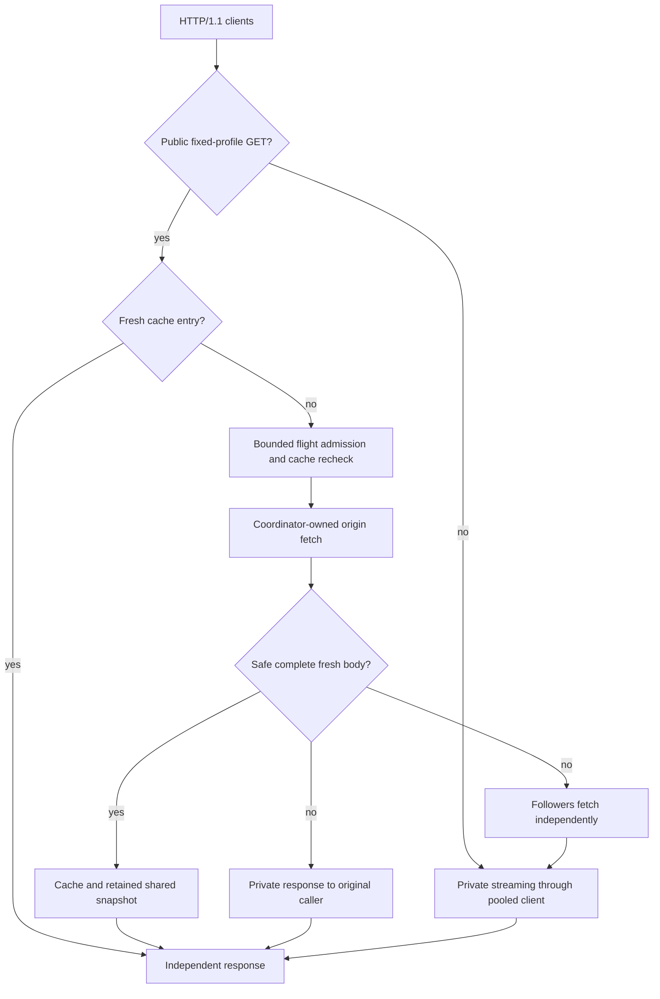

# WireCache

[](https://github.com/manavkdubey/Wirecache/actions/workflows/ci.yml)

A single-origin Rust HTTP/1.1 reverse proxy with conservative response caching and cancellation-safe single-flight coalescing. In the controlled concurrency test, **100 compatible pending misses produce one origin fetch**, while each caller receives its own correct response.

This is a portfolio systems project: bounded work, explicit failure behavior, privacy regression tests, and reproducible measurements. It does not claim production CDN readiness or full RFC 9111 conformance.

## Run the demo

Requires stable Rust and Python 3 on Linux. Scripts build release binaries, start their own loopback services on temporary ports, and clean up only their own processes.

```sh
./scripts/demo_stampede.sh
```

The demo compares 100 pass-through requests with a 100-client cold burst: the origin should see **100 requests versus 1**, with zero client errors. Commands and a manual two-terminal version are in [the demo guide](docs/DEMO.md).

To use your own trusted HTTP origin:

```sh
cargo run --release -- --upstream http://127.0.0.1:9000 --cache-path-prefix /public/
curl -s -D - -o /dev/null -H 'User-Agent:' http://127.0.0.1:8080/public/data
curl http://127.0.0.1:8080/metrics
```

The origin must explicitly mark the response public and fresh. Curl's default User-Agent is removed because extra headers deliberately bypass the fixed cache profile. Caching is disabled when no public prefix is configured. `cargo run -- --help` lists limits; `/healthz` and `/metrics` are reserved locally.

## How it works



- Only bodyless GETs on explicitly public paths qualify. Authorization, cookies, ranges, conditionals, request directives, extra headers, and encoded/dot-segment paths bypass caching and coalescing. Candidate Host/Accept/Accept-Encoding are standardized.
- Only complete bounded 200 responses with explicit shared freshness qualify. Vary, cookies, private/no-store/no-cache, content encoding/ranges, trailers, and ambiguous directives prevent sharing/storage. Date, Age, buffering time, and monotonic residence determine remaining freshness.
- Owned fetches survive caller disconnects. Retained terminal outcomes prevent missed wakeups; every waiter has a deadline. Unsafe responses use a private handoff, with bounded independent follower fetches.
- Same-target mutations invalidate entries and version tokens. Later callers cannot join older flights, and old completion cannot erase a replacement or refill stale storage.
- LRU storage, connections, origin calls, flights, and waiters have explicit bounds. Candidate overflow replays every buffered byte and streams privately. Independent idle and origin-transfer watchdogs release stalled connections and permits.

Defaults: 64 MiB accounted cache data, 4096 entries, 1 MiB per candidate body, 128 connections, 64 origin calls/flights, 128 callers per key, 1024 total waiters, three-second origin deadline, five-second waiter deadline, and ten-second network inactivity limit. Overload returns 503 with Retry-After; connection admission overflow closes the new socket. Ctrl-C cancels shared work and drains direct connections for up to five seconds.

## Recorded measurements

Local reference: AMD Ryzen 7 4800H, Linux, Rust 1.99.1, two Tokio workers per process, 4 KiB responses, 200 ms origin delay, and three repetitions. Values below are medians of run-level results; proxy RSS is the maximum recorded across those runs. **All 12 cases had zero errors.**

| Mode | Requests / concurrency per run | p99 ms | Requests/s | Origin fetches | Proxy peak RSS MiB |
|---|---:|---:|---:|---:|---:|
| Direct origin | 600 / 32 | 202.71 | 156.53 | 600 | — |
| Pass-through | 600 / 32 | 203.44 | 156.09 | 600 | 6.75 |
| Warm cache | 100,000 / 32 | 0.78 | 72,339.41 | 0 | 6.04 |
| Cold burst | 100 / 100 | 203.68 | 490.06 | 1 | 7.02 |

The cold burst is one batch, not sustained throughput. These are shared-environment microbenchmarks with a small working set, not production capacity or worst-case memory claims. See [methodology, p50/p95, CPU, and caveats](docs/BENCHMARKS.md), [raw data](bench/reference/2026-10-31/), and [resume facts](docs/RESUME.md).

```sh
./scripts/bench.sh
```

New JSON, CSV, compressed raw samples, and process logs go into an ignored timestamped `bench/results/` directory. Warmup is excluded, origin counters are measured, and the harness rejects failed correctness checks.

## Verify

```sh
cargo fetch --locked
cargo fmt --check
cargo clippy --offline --locked --all-targets -- -D warnings
cargo test --offline --locked
python3 -m unittest discover -s scripts/tests
```

The suite contains **71 Rust tests and 7 Python analysis/export tests**, including controlled multithreaded coalescing, cancellation/panic cleanup, privacy, framing, mutation races, stalled readers/uploads, admission pressure, and buffer accounting. CI runs checks, release builds, and the stampede demo.

## Scope and design record

P0 is implemented. P1 features such as validator revalidation and selected Vary variants are future work. TLS, HTTP/2/3, tunnels, distributed coordination, persistence, arbitrary origins, and production CDN behavior are outside scope. Updates outside this proxy and related-URL invalidation are not observed. Already-started body failures terminate the connection; they cannot replace the status. Healthy keep-alive connections have no fixed lifetime.

Read the [threat model](docs/THREAT_MODEL.md), [resource/memory model](docs/RESOURCE_LIMITS.md), [metric semantics](docs/METRICS.md), and [release review](docs/RELEASE.md). Decisions: [fixed origin](docs/adr/ADR-001-fixed-origin.md), [cache policy](docs/adr/ADR-002-cache-policy.md), [buffering](docs/adr/ADR-003-body-buffering.md), [flight ownership](docs/adr/ADR-004-flight-lifecycle.md), [publication ordering](docs/adr/ADR-005-flight-publication.md), and [LRU/invalidation](docs/adr/ADR-006-cache-storage.md).

Requirements and workflow: [PRD](WireCache_PRD.md), [technical design](WireCache_Technical_Design.md), [agent guidelines](WireCache_Agent_Prompt.md). Git history is an explicitly labeled reconstruction; benchmark artifacts retain actual measurement timestamps.
