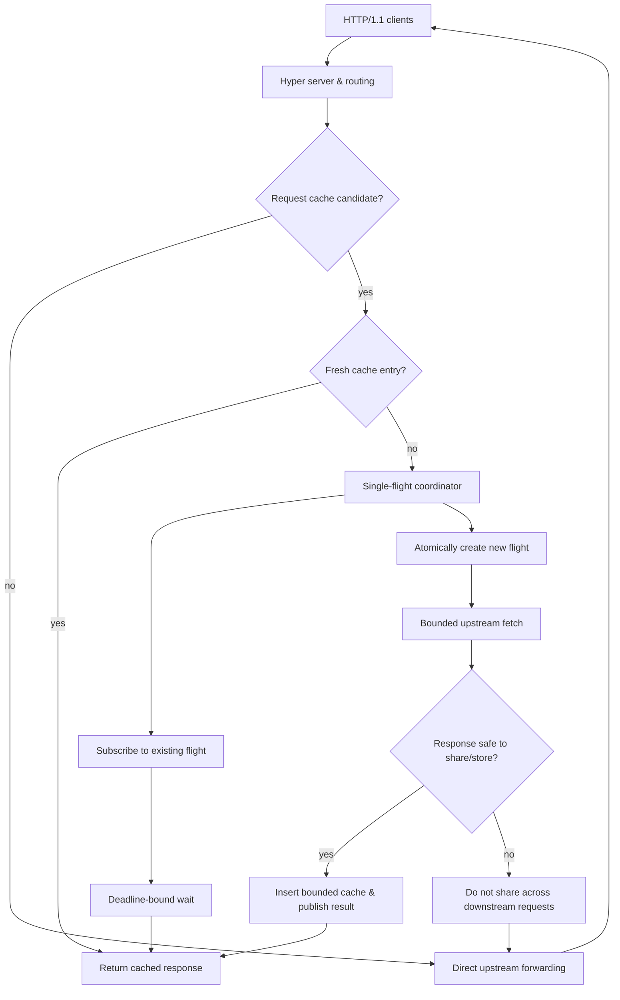

# WireCache — Technical Design

**Status:** P0 implemented with regression tests, ADRs, and [reference benchmarks](docs/BENCHMARKS.md). ETag revalidation is implemented as a P1 extension ([ADR-007](docs/adr/ADR-007-etag-revalidation.md)); other P1/P2 features remain future work.

## 0. Design contract
Implement a **single-process, single-trusted-origin, HTTP/1.1** reverse proxy. The primary engineering contribution is correct single-flight **only for compatible, conservatively cacheable candidate GETs**. The cache is not a general RFC-compliant shared cache. Never claim exactly-once upstream fetching under failures or across process restarts; claim one upstream fetch for a deterministic simultaneously pending compatible burst when healthy and inside configured bounds.

## 1. Architecture

**Important correction to diagram:** The coordinator decides *after reading origin headers* whether a response may be shared. If not, only the designated leader caller receives the response; followers are instructed to reissue independent bypass fetches (or get a `RetryUnshared` terminal state). They must **not** inherit an unsafe response. To avoid first caller disconnect killing the flight, the upstream task belongs to the coordinator; for nonshareable response it transfers ownership/result to a leader-owned oneshot before cleanup. If leader disconnected, discard that result; followers independently bypass. You may simplify further by requiring `GET` candidates to be explicitly public paths configured via an allowlist to ensure predictable sharing, while still evaluating response headers.

## 2. Component boundaries
```text
src/
  main.rs             # CLI, tracing init, graceful shutdown
  config.rs           # validated resource limits and fixed origin
  server.rs           # Hyper accept loop, request handling
  upstream.rs         # pooled Hyper-util client and timeouts
  headers.rs          # request/response hop-by-hop sanitization
  policy.rs           # pure cache eligibility and freshness rules
  cache.rs            # bounded bytes+entries LRU or documented FIFO
  flight.rs           # key -> owned flight state and terminal results
  response.rs         # immutable response snapshot + reconstruction
  telemetry.rs        # counters, histograms, safe event fields
  error.rs            # mapping failures to HTTP error status
 tests/
   origin_fixture.rs  # local controllable server + request counter
   proxy_integration.rs
   coalescing.rs
   security_policy.rs
   failure_injection.rs
 benches/ or scripts/
 docs/adr/
```
Prefer a small number of modules, not a multi-crate microservice architecture.

## 3. Technology choices
- Rust stable edition 2024 if installed toolchain supports it.
- Tokio (runtime, cancellation, synchronization, timers).
- Hyper 1.x with hyper-util for server/client Tokio integration, HTTP/1.1; `http-body-util`, `bytes`.
- `clap` for CLI; `tracing`, `tracing-subscriber`; `metrics` or lightweight Prometheus encoder; `serde` if configuration needs it.
- `moka` optional bounded cache if it fits invariants; otherwise a small mutex-protected cache with explicit byte accounting. Avoid multiple cache libraries simultaneously.
- `criterion` or `oha`/`wrk` for load generation, shell scripts for reproducibility.
Use `cargo add` to resolve current compatible versions; do not assume legacy Hyper 0.14 APIs.

## 4. Request/response handling
1. Determine whether request targets reserved health/metrics paths.
2. Reject unsupported protocol upgrade/CONNECT; fixed upstream prevents open proxy.
3. Rewrite upstream URI to configured origin plus original path and query. Set upstream Host correctly. Do not accept arbitrary client-supplied authority to choose origin.
4. Remove hop-by-hop headers (`Connection` and all connection-nominated fields; `Proxy-Connection`, `Keep-Alive`, `TE`, `Trailer`, `Transfer-Encoding`, `Upgrade`, proxy auth headers as appropriate); let Hyper rebuild framing.
5. Forward request streaming whenever practical. For P0, client request bodies are passed through but non-GET responses are never cached.
6. Strip hop-by-hop headers on response; handle conflicting `Content-Length` and transfer encoding through HTTP framework protections.
7. On cache hit, reconstruct a new independent response from immutable status, headers, `Bytes`. Avoid leaking connection-specific headers.
8. Preserve user-safe errors: timeout -> 504, connect/transport failure -> 502, capacity exceeded -> 503, internal failure -> 500. Don't reveal upstream credentials.

## 5. Cache admission: deliberately conservative P0
**Request is eligible for cache AND coalescing only if:**
- GET; no body; no Authorization, Cookie, Range, If-* headers, no Cache-Control bypass directives; no Pragma: no-cache; no upgrade.
- Valid target and only fixed origin; normalized key includes method, upstream identity, path and query. Preserve percent-encoding and query order unless normalization is proven safe (default: use unchanged path/query).
- No request header that the origin could use to choose personalized representation **unless a local allowlist policy guarantees the endpoint is public and invariant across request headers**. Recommended P0: configure `--cache-path-prefix /public/` and strip/standardize response-varying request headers as appropriate. This is critical: `Vary` is only known after origin responds, so coalescing *before* inspecting it needs an assumption of equivalent requests. For strict correctness across arbitrary clients, single-flight only if headers are canonicalized to a fixed safe profile for an explicitly public route; otherwise bypass coalescing.
- Accepted profile: Host, Connection close/keep-alive, optional zero Content-Length, Accept `*/*`, and Accept-Encoding `identity` only. Standardize candidate Host/Accept/Accept-Encoding and omit explicit Content-Length. All extra headers and encoded/dot-segment paths bypass. See [ADR-002](docs/adr/ADR-002-cache-policy.md).

**Response is cacheable only if:**
- 200 OK; no `Set-Cookie`; `Cache-Control: public, max-age=N` or `s-maxage=N` with valid positive N; no `private`, `no-store`, `no-cache`, `must-understand`, malformed/conflicting directives, or Vary. (P0 deliberately rejects `Vary` entirely.)
- No `Content-Range` or 206, `Content-Encoding`, or announced/unannounced trailers; Date/Age must parse unambiguously; body is successfully read and size ≤ max entry.
- The request is inside a public endpoint allowlist, and request headers forwarded to the origin are a fixed/allowlisted representation-affecting set. **Do not cache personalized or user-dependent responses.**
- P0 implements explicit Date/Age freshness and updates Age on cached responses. Validators, variants, and broader HTTP cache semantics remain unsupported; do not claim full RFC 9111 compliance.

Important nuance: `Cache-Control: public` does not by itself imply safe treatment of every request context. The conservative local public-route allowlist and auth/cookie rejection are intentional defense in depth. Do not cache if header parsing is ambiguous.

**Freshness:** `initial_age = max(apparent_date_age, Age + response_delay)`. Use `s-maxage` when present; otherwise require `public, max-age`. Remaining freshness is lifetime minus initial age, capped by configured local retention. Expiry starts at header receipt, so buffering consumes freshness. Monotonic residence increases outgoing Age. If no valid explicit freshness -> bypass. Never serve stale entries.

**Mutation:** P0 bypasses non-GET methods. Conservatively invalidate the same target at unsafe-attempt admission and completion, even on failure/cancellation. Version tokens fence older fills, with tracking retained only for bounded active work. Do not claim complete HTTP invalidation semantics. See [ADR-006](docs/adr/ADR-006-cache-storage.md). Cache immutable/public demonstration routes by default.

## 6. Data models (pseudocode; NOT copy/paste-ready Rust)
```rust
struct CacheKey { origin_id: OriginId, path_and_query: String }
struct Snapshot { status: StatusCode, headers: HeaderMap, body: Bytes, stored_at: Instant, expires_at: Instant }
struct FlightId(u64);
enum FlightOutcome {
    Shared(Arc<Snapshot>),      // verified cacheable and shareable
    RetryUnshared,             // not eligible after response headers/body; waiter must bypass
    Failed(SharedError),
}
struct Flight {
    id: FlightId,
    tx: watch::Sender<Option<Arc<FlightOutcome>>>,
}
struct FlightTable { /* synchronized HashMap<CacheKey, Arc<Flight>> */ }
struct Cache { /* entry count cap + byte cap, eviction */ }
struct Limits { max_flights: usize, max_waiters_per_key: usize, max_cache_bytes: usize, max_entry_bytes: usize }
```
A terminal outcome is immutable and retained long enough for subscribers to observe. Subscribers use `watch` properly; see Tokio docs about `borrow_and_update()` and `changed()`. Alternatively `Notify` + a mutex-protected terminal state, but avoid lost wakeups and prove notification registration order.

## 7. Single-flight protocol and invariants
**Atomic election**
1. Check fresh cache.
2. Acquire flight-table lock. Under the lock, check cache *again* or arrange a combined admission critical section; otherwise miss→leader gap can issue a redundant second origin fetch after previous flight completes. If cache lock and table lock are separate, define a consistent lock order or use a per-key coordinator state containing both cached and in-flight values.
3. If matching flight exists, increment waiter count under cap and subscribe; else check global flight cap, install a new flight with unique id, spawn an **owned** fetch task, then subscribe. Never hold sync locks during `.await`.
4. Owned task fetches origin with timeout/body size bound. It determines whether result may be safely shared. If yes, publishes snapshot and attempts cache insertion; cache publication and flight completion must be ordered so new callers see either the current flight or a fresh entry.
5. If response is not shareable, publish `RetryUnshared` to followers. The original leader's response is delivered privately if still connected; all followers perform independent uncached requests with their own limits; they must not enter the same flight again in an infinite loop.
6. On error publish `Failed` and remove flight, permitting a later request to retry. On panic, task cancellation, or shutdown, use a drop/guard/supervisor mechanism so the flight reaches a terminal outcome or waiters time out and entry is cleaned.
7. Delete flight table entry only if its `FlightId` matches the completed task; a slow old task must not delete a replacement.

**Invariants:**
- At most one active coordinator flight per eligible key per process, within bounded healthy operation.
- Every enrolled follower observes one terminal outcome (or its own timeout) without indefinite waiting.
- No follower gets an unsafe or non-equivalent origin response from a leader.
- Cached entries are immutable snapshots; no partial body enters the cache.
- Cache and flight table do not retain unbounded keys, waiters or bodies.
- Leader downstream disconnect does not cancel shared origin flight.
- Failed outcome is not cached; later requests may initiate a fresh flight.

**Cancellation edge cases:** first caller drops; follower drops; fetch task panics; whole server shuts down; last waiter disappears; timer fires just as value is published. Design cancellation cleanup and test all of these.

**Race test:** barriers arrange 100 concurrent arrivals before upstream completes. Assert `origin_counter == 1`, every result correct. Additional barrier tests exercise leader cancellation and table cleanup while a replacement request arrives.

## 8. Body & memory strategy
For eligible cache paths, buffer **only up to** `max_entry_bytes`; never use unbounded `collect()` when response length is unknown. Accepted P0 behavior: on overflow, privately replay the buffered prefix and crossing chunk, then stream the remainder with backpressure. Do not cache or announce a shared success; eventual followers retry independently under admission limits. Bypass traffic streams directly. See [ADR-003](docs/adr/ADR-003-body-buffering.md).

Memory upper bound should be explainable: cache cap + (max concurrent eligible flights × max per-entry buffering) + bounded metadata/waiter overhead + upstream transport buffers. Bound global number of waiters, not just per-key, if necessary.

## 9. Timeouts, overload, shutdown
- Connect timeout, total origin response timeout, body-read timeout, downstream waiter timeout.
- Monitor active-origin streaming deadlines and configurable connection inactivity independently of body polling. Successful transfer completion disarms its deadline; see [resource bounds](docs/RESOURCE_LIMITS.md).
- Global semaphore for upstream requests including bypass; limits for concurrent flights; cap waiters and key count.
- On limit hit, default 503 + `Retry-After: 1`; do not overflow arbitrary queues.
- Clean shutdown rejects new requests, finishes/aborts flights within deadline, publishes terminal cancellation if possible and drains active connections.
- No retry of unsafe methods by proxy; P0 no automatic retry of GET unless separately specified and tested.

## 10. Observability and benchmarking
**Counters:** total requests by result, upstream attempts by outcome, cache hits/misses, flight created/joined, rejects, fallback to unshared, cache evictions, expiration.
**Gauges:** cache bytes/entries, active flights, waiters, active upstream calls.
**Histograms:** upstream latency, proxy end-to-end latency, wait duration, body bytes.
Implemented proxy-side latency observations end at body production/consumption, failure, or cancellation; they cannot measure peer receipt. Client-measured end-to-end distributions belong to the benchmark harness. See [metric semantics](docs/METRICS.md).
Avoid high-cardinality labels (URL/user IDs) and sensitive HTTP header logging.

Four benchmark modes: direct origin, proxy without cache, proxy warm hit, proxy cold burst. Emit JSON/CSV artifacts to `bench/results/` with command, machine, times, payloads, counters. Distinguish throughput from origin fetch suppression. Compare on identical upstream conditions and advertise representative distributions, not cherry-picked best runs.

## 11. Testing matrix
**Unit:** directive parser (duplicates, quoted values, overflow), cache key canonicalization, TTL clamp, header sanitization, LRU byte accounting and eviction, error mapping.

**Integration:**
- Mixed GET query variants (distinct cache entries), cache hit/expiry, response header fidelity, 100 concurrent same-key, two simultaneous different keys, leader abort, follower abort, timeout and error recovery, late subscriber after publication, stale old task vs replacement, `Vary`/Set-Cookie/no-store/private/Authorization/Cookie/Range/If-* isolation, slow chunked body, oversize body, broken upstream transfer, healthy/overloaded limits, shutdown.
- Instrument origin request counter and block/release responses via barriers or channels to avoid flaky timing-only tests.
- Propagate random but deterministic seeded schedules where useful; use Loom selectively for self-contained synchronization primitives if feasible.

**Security regression:** Host header manipulation must not route to arbitrary hosts; hop-by-hop headers not leaked; client A's credential/cookie response never reaches B; no Cache-Control ambiguous parser fail-open; no unbounded memory on huge bodies.

## 12. ADRs to write
- ADR-001: Fixed single origin vs dynamic upstream and open-proxy risk.
- ADR-002: Why conservative public-route cache eligibility and bypass Vary.
- ADR-003: Buffering / oversized response fallback semantics.
- ADR-004: `watch` vs `Notify` vs oneshot for terminal fanout; cancellation.
- ADR-005: Atomicity between completed flight publication and cache insertion.
- ADR-006: Cache eviction policy and accounting.

## 13. Interview defense questions
1. What does *single-flight* guarantee, and what does it **not** guarantee across failures?
2. How do you avoid lost wakeups when a subscriber joins just as a flight completes?
3. How can a malformed `Vary` or Cookie cause a cross-user leak?
4. Why can't you share the response before inspecting origin response headers?
5. How do you enforce a memory bound on chunked transfer bodies without Content-Length?
6. Does `public, max-age` guarantee coalescing safety for requests with different headers?
7. How does the coordinator survive the first client disconnect?
8. Why is `exactly once` an inappropriate claim for general upstream side effects?
9. What is the benchmark baseline? What overhead does the proxy add on a miss?
10. What happens when response expiry overlaps with an in-flight request?

## 14. References
- RFC 9111: https://www.rfc-editor.org/rfc/rfc9111.html
- RFC 9110 semantics: https://www.rfc-editor.org/rfc/rfc9110.html
- Hyper API: https://docs.rs/hyper/latest/hyper/
- hyper-util pooled client: https://docs.rs/hyper-util/latest/hyper_util/client/legacy/
- Tokio watch: https://docs.rs/tokio/latest/tokio/sync/watch/
